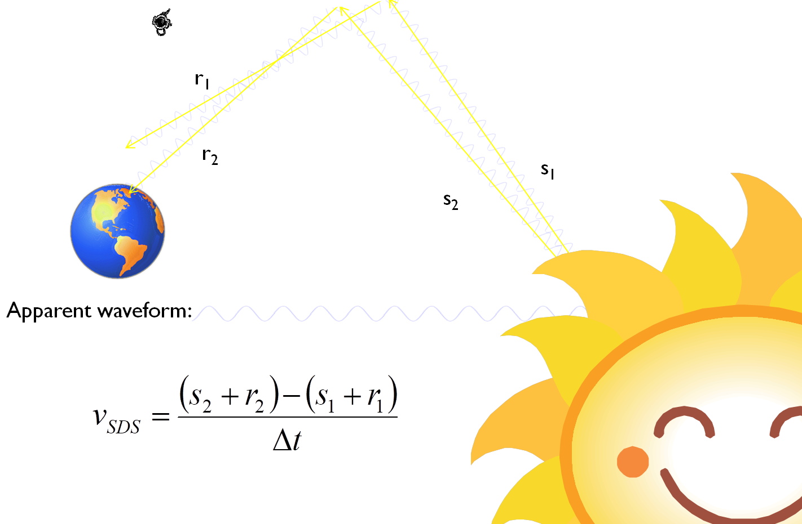

# Constraining the Orbits of Small Solar System Bodies Using Spectroscopic Doppler Shift Measurements

## Repository Description
This repository contains all files relevant to the thesis prepared as part of the work for my M.Sc. from [the Department of Geophysical, Atmospheric and Planetary Sciences](https://en-exact-sciences.tau.ac.il/earth) of [Tel Aviv University](https://english.tau.ac.il).
This work has also been published as an academic paper in the [Astronomische Nachrichten](https://www.aip.de/AN) journal ([pages 634-637](https://OnlineLibrary.wiley.com/doi/10.1002/asna.201412198) of [volume 336, issue 7](http://OnlineLibrary.wiley.com/doi/10.1002/asna.v336.7/issuetoc)) on 10 September 2015, and was referenced in works by others authors, such as [Pantalone & Kudenov (2017)](https://www.spiedigitallibrary.org/conference-proceedings-of-spie/10407/2274804/Fraunhofer-line-optical-correlator-for-improvement-of-initial-orbit-determination/10.1117/12.2274804.full?tab=ArticleLinkReference#:~:text=9.%C2%A0S.%20Zucker,(2015).) and [Pantalone & Kudenov (2018)](https://link.springer.com/article/10.1007/s10569-018-9878-9#:~:text=Zucker,(2015)).

## Repository Structure
This section contains a description of the contents of the folders in this repository; originally everything (calculations and results) was in a single folder, but I broke it into subfolders here for clarity:
* [Thesis/](Thesis) – contains the final (.pdf) files submitted as the manuscript of my thesis, plus its presentation; see **README.md** therein for description of each file.
* [src/](src) – contains the Matlab function (.m) files I created for the thesis (most constants and equations in which have been taken from [*Solar System Dynamics* by C. D. Murray and S. F. Dermott](https://studylib.net/doc/28386210/solar-system-dynamics----carl-d--murray--stanley-f--dermo...)); originally, all these files were in a single folder, but I broke them into subfolders here for clarity:
  * [Generic/](src/Generic) – contains generic Matlab function (.m) files, i.e. ones used for all studied objects; see *Generic Functions* below.
  * [Cases/](src/Cases) – contains Matlab function (.m) files used for each studied object; see *Specific Functions* below.
* [Results/](Results) – contains results of running the calculations of the source files for the thesis:
  * [SessionOutputs/](Results/SessionOutputs) – contains sessions (that generated the results used in the final thesis and published paper), copied from the Matlab window as text files.
  * [Environments/](Results/Environments) – contains output (.mat) files saved from these sessions, for storing local variables and results.
  * [Plots/](Results/Plots) – contains graphic images generated by these sessions and used in the thesis manuscript; originally, all these images were generated into a single folder, but I broke them into subfolders here for clarity:
    * [Orbits/](Results/Plots/Orbits) – contains plots showing, for each studied object, the projection of its orbit on the ecliptic plane (solid line) along with Earth's orbit (dashed line), its perihelion, and locations (and dates) of simulated observation points (before introducing observation errors). The `plot_object.m` function (from the `Generic` folder below) was used for generating these plots.
    * [Astrometric/](Results/Plots/Astrometric) – contains plots showing, for each studied object, the equatorial coordinates(right-ascension and declination) of its astrometric track in the five simulated observation points (before introducing observation errors). The first half of the `track_*.m` function (from the `Cases` folder below) was used for generating these plots.
    * [Doppler/](Results/Plots/Doppler) – contains plots showing, for each studied object, its SDS measurements in the five simulated observation points (before introducing observation errors). The second half of the `track_*.m` function (from the `Cases` folder below) was used for generating these plots.
    * [Spreads/](Results/Plots/Spreads) – contains plots showing, for each studied object, observation-error spreads (the spread of each resulting orbital element around the mean) of its 5,000 runs. Each row of plots in these files represents a simulated observation type, each column – a calculated orbital element. The `plot_spread.m` function (from the `Generic` folder below) was used for generating these plots.
    * [Histograms/](Results/Plots/Histograms) – contains plots showing, for each studied object, observation-error histograms (the count of errors of each resulting orbital element around the mean) of its 5,000 runs. Each row of plots in these files represents a simulated observation type, each column – a calculated orbital element. The `hist_object.m` function (from the `Generic` folder below) was used for generating these plots.

### Specific Functions
The `Cases` subfolder mentioned above contains the following Matlab function files for each studied object:
* `*_orb.m` – returns the orbital elements of the object and five simulated observation dates – #1, #2, #4 and #5 evenly spaced, and #3 roughly at the midpoint between #2 and #4. (Uses the `M2tau` function from the `Generic` folder below.)
* `test_*.m` – receives a number `n`, runs the test (of this thesis) `n` times on the object, and returns the test results. (Uses the `*_orb` function mentioned above and the `test_n` function from the `Generic` folder below.)
* `track_*.m` – plots the object's astrometric orbit and Doppler trace. (Uses the `*_orb` function mentioned above and the `plot_track` function from the `Generic` folder below.)

### Generic Functions
The `Generic` subfolder mentioned above contains the following Matlab function files for all objects:
* `M2tau.m` – receives an object's JD epoch `t`, its mean anomaly (in degrees) `M` for the given `t`, and its semi-major axis `a` in AU, and returns its JD time of perihelion passage.
* `earth_orb.m` – returns the orbital elements of Earth. (Uses the `M2tau` function mentioned above.)
* `kepler_eq.m` – solves the Kepler equation iteratively.
* `ast_pos.m` – receives an object's orbital elements and a vector of astrometric observation times, and returns corresponding vectors of Cartesian positions (X, Y, Z) at the given observation times (in m). (Uses the `kepler_eq` function mentioned above.)
* `ast_vel.m` – receives an object's orbital elements and a vector of Doppler observation times, and returns corresponding vectors of Cartesian velocities (dX/dt, dY/dt, dZ/dt, dr/dt) at the given observation times (in m/s). (Uses the `earth_orb` and `kepler_eq` functions mentioned above.)
* `ast_orb.m` – receives an object's orbital elements, a vector of astrometric observation times, and a vector of Doppler observation times, and returns corresponding vectors of observations (right-ascensions, declinations and Doppler-shifts) at the given observation times. (Uses the `earth_orb`, `ast_pos` and `ast_vel` functions mentioned above.)
* `spread.m` – receives a `matrix` of numbers and an equal-sized matrix of `errors`, and returns a matrix of numbers normally spread around the given `matrix` according to the given error distribution.
* `gen_obs.m` – receives an object's orbital elements, a vector of astrometric observation times, a vector of Doppler observation times, a vector of expected errors of right-ascensions (in degrees), a vector of expected errors of declinations (in degrees), and a vector of expected errors of Doppler-shifts, and returns observations (right-ascensions, declinations and Doppler-shifts) normally spread around the exact coordinates according to the expected error distribution. (Uses the `ast_orb` and `spread` functions mentioned above.)
* `chi2.m` – receives an object's orbital elements, a vector of astrometric observation times, and a vector of Doppler observation times, vectors of astrometric-observation (right-ascension and declination) guesses, a vector of Doppler-observation guesses, vectors of expected astrometric-observation (right-ascension and declination) errors, and a vector of expected errors of Doppler-shifts, and returns the chi2 error of the guesses. (Uses the `ast_orb` function mentioned above.)
* `test_chi2.m` – receives an object's orbital elements, vectors of astrometric-observation (right-ascension and declination) guesses, a vector of Doppler-observation guesses, a vector of astrometric observation times, a vector of Doppler observation times, a vector of expected errors of Doppler-shifts, a tolerance parameter (for TolFun and TolX in fminsearch), and a minimum number of iterations, and returns the object's orbital elements calculated by applying chi2 on gen_obs results, and the number of iterations performed by fminsearch. (Uses the `chi2` function mentioned above.)
* `test_n.m` – receives an object's orbital elements, five simulated observation `dates`, the desired number `n` of tests to perform, a tolerance parameter (for TolFun and TolX in fminsearch), and a 5-element vector `minIterations` of the minimum number of iterations for each type of test, runs the test `n` times, and returns a (`n`x6) matrix in which each row contains calculated orbital elements of the object, and a (5x`n`) matrix in which each column contains the number of iterations (performed by fminsearch) for each of the 5 test types. (Uses the `juliandate` function provided by MathWorks and the `gen_obs` and `test_chi2` functions mentioned above.)
* `plot_track.m` – receives an object's name, its orbital elements, and a matrix where each row is an observation date to be plotted, and plots its observed track during the given observation dates. (Uses the `juliandate` function provided by MathWorks and the `ast_orb` function mentioned above.)
* `hist_object.m` – receives a matrix of an object's orbital-element `results` from the tests, and the number of bins to be used by the `hist` function, and plots histograms of the `results`, per scenario and element.
* `plot_spread.m` – receives a matrix of an object's orbital-element `results` from the tests, and a matrix where each column contains the number of iterations (performed by `fminsearch` for each of the 5 test types), and plots the spread of each of the object's orbital element in the `result` around the mean.
* `period.m` – receives the semi-major axis of an object's orbit around the Sun (in m), and returns its period (in s).
* `plot_object.m` – receives an object's name, its orbital elements, and a matrix where each row is an observation date to be plotted, and plots its locations during the given observation dates. (Uses the `juliandate` function provided by MathWorks and the `earth_orb`, `ast_pos` and `period` functions mentioned above.)

## Acknowledgement
All the work done for this thesis, both theoretical and practical, has been carried out under the guidance and supervision of [Prof. Shay Zucker](https://en-exact-sciences.tau.ac.il/profile/shayz) from [the Department of Geophysical, Atmospheric and Planetary Sciences](https://en-exact-sciences.tau.ac.il/earth) of [Tel Aviv University](https://english.tau.ac.il). He suggested the idea of reducing errors in orbital elements by introducing solar Doppler shift measurements, and worked up the method of testing this idea. I thank him for his advice about orbital dynamics and computation approach, without which this work could not have been made.

Prof. Zucker is also the one who sent this work for publishing in the [Astronomische Nachrichten](https://www.aip.de/AN) journal.
